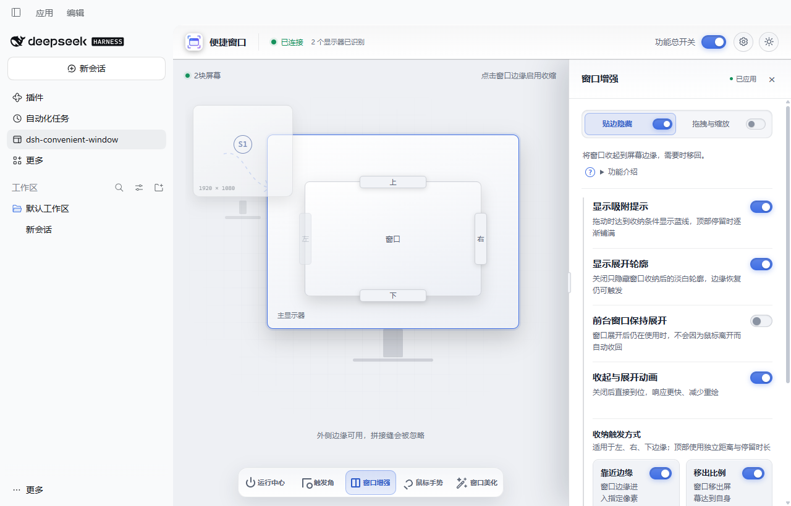
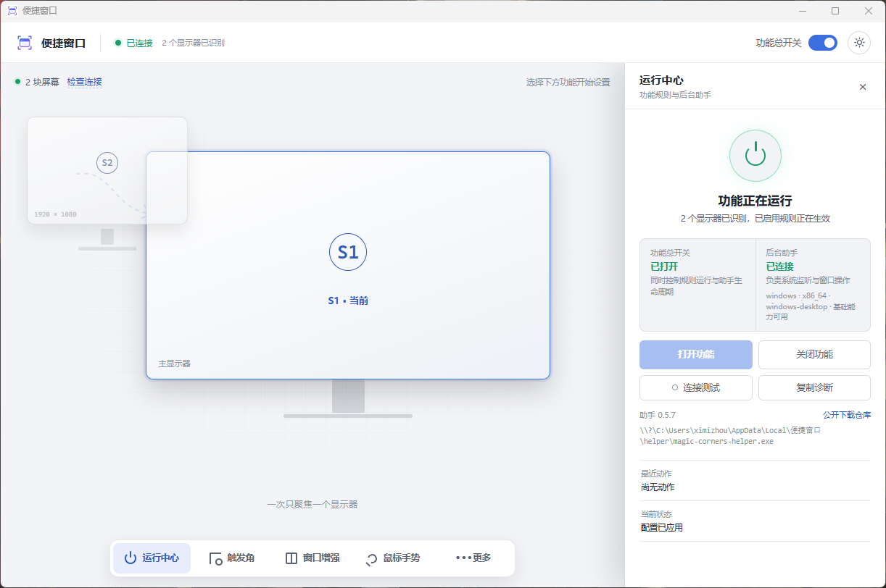
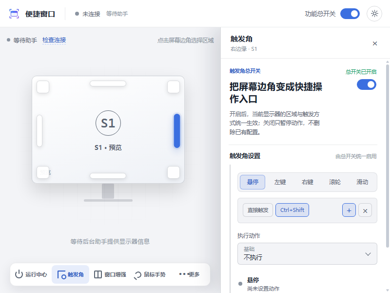
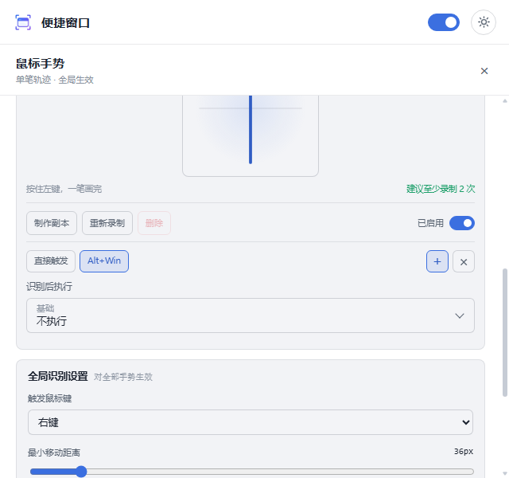

<div align="center">


<h1>Convenient Window</h1>

<p><strong>Tuck windows away. Keep everyday actions within reach.</strong></p>
<p>Hot corners, edge hiding, mouse gestures and window layouts, in one settings panel.</p>

<p>
  <a href="https://github.com/ximizhou/convenient_window_free/releases/tag/v0.6.11"></a>
  <a href="https://github.com/ximizhou/convenient_window_free/releases/tag/dsh-v0.2.0-beta.3"></a>
  
</p>

<p><a href="README.zh-CN.md">简体中文</a> · <strong>English</strong></p>

</div>

## Choose your edition

| Standalone desktop | DSH plugin |
| --- | --- |
| **Install and use it from the system tray. No other host required.** | **Already using DeepSeek Harness? Open it in the sidebar.** |
| Stable **0.6.11**, with an installer and portable ZIP. | Beta **0.2.0-beta.3**, tested with DSH **0.2.2-rc.5**. |
| [**Download desktop**](https://github.com/ximizhou/convenient_window_free/releases/tag/v0.6.11) · [Get started](#desktop-quick-start) | [**Install DSH plugin**](#use-it-in-dsh) · [Release and downloads](https://github.com/ximizhou/convenient_window_free/releases/tag/dsh-v0.2.0-beta.3) |

Both editions use the same settings UI and Rust window engine. The helper is bundled, so no second download is required. Settings are stored separately; run the window helper from only one host at a time.

## Use it in DSH



*An actual DSH tab, shown in Chinese; the plugin UI also supports English. The enabled helper keeps running when you switch tabs or minimize DSH.*

Open DSH once to initialize its desktop profile, then quit it from the system tray. Run this in PowerShell:

```powershell
dsh plugin --profile desktop add dsh-convenient-window@0.2.0-beta.3 --ignore-scripts --registry=https://registry.npmjs.org/
```

Reopen DSH, select **dsh-convenient-window** in the sidebar, and turn on the main switch when ready. If `dsh` is not on PATH, invoke `resources/runtime/cli/bin/dsh.cmd` inside your DSH installation directory.

For the old package name `dsh-plugin-convenient-window`, turn off its login startup first if enabled, quit DSH, remove the old package, then install the new one. Existing settings remain in the same profile. [Detailed installation and migration guide (Chinese)](apps/dsh-plugin/README.md#安装) · [Report a problem](https://github.com/ximizhou/convenient_window_free/issues/new/choose)

## What you can do

| Feature | Everyday use |
| --- | --- |
| **Edge hiding** | Tuck an ordinary window against a screen edge; point at its exposed strip to bring it back. |
| **Hot corners and zones** | Assign actions to each display's four corners and edges, such as showing the desktop, changing volume or sending shortcuts. |
| **Mouse gestures** | Use one-stroke gestures for window controls, shortcuts and custom actions. |
| **Window layouts** | Save a window arrangement and restore its positions, sizes and supported window states. |
| **Screenshots, pinned images and OCR** | Capture an area, float it above other windows, and recognize text using local Windows APIs. |
| **Window controls and preferences** | Move and resize from anywhere, pin windows, manage startup applications, and switch language or theme. |

<details>
<summary><strong>See the desktop edition and more screenshots</strong></summary>

### Standalone desktop



### Hot corners and window layouts




### Mouse gestures



</details>

## Desktop quick start

1. Download the `setup.exe` installer from the [desktop release](https://github.com/ximizhou/convenient_window_free/releases/tag/v0.6.11). Choose the portable ZIP if you prefer extracting and running the app.
2. Open Convenient Window from the system tray, turn on the main switch, and enable the features you want.
3. Drag an ordinary, non-maximized window to an enabled edge. Release when the blue hint appears; at the top edge, wait for the line to fill.
4. Point at the exposed strip to restore the window. Use the gear button to change language, theme and feature entries.

Closing settings leaves the desktop app running in the tray; use the tray menu to quit. To update the portable edition, replace the program files. Settings remain in the local application data directory.

## Recent changes

**DSH 0.2.0-beta.3**

A DSH sidebar entry using the desktop settings UI, native modules and bundled 0.6.11 helper. The package is named `dsh-convenient-window` and is available through npm and a GitHub release download. [Installation and old-name migration](apps/dsh-plugin/README.md)

**Desktop 0.6.11**

Fixed edge-hidden windows reopening when another app closes and restore strips appearing on the wrong virtual desktop. Settings with many gesture samples save faster. [Full release notes](docs/release-notes/0.6.11.md)

[All releases](https://github.com/ximizhou/convenient_window_free/releases) · [Desktop 0.6.10 rollback](https://github.com/ximizhou/convenient_window_free/releases/tag/v0.6.10)

## Before you start

- **Support:** Published and accepted packages target Windows 11 x64. The DSH plugin declares only the tested DSH 0.2.2-rc.5 version. Other host versions need separate verification. macOS/Linux implementation boundaries exist, but there are no accepted packages for this release.
- **Local processing:** Window operations, settings and OCR stay on your machine. OCR does not upload screenshots and depends on installed Windows language packs.
- **Updates:** Download desktop updates manually. The DSH adapter and window engine have separate versions so host compatibility can be updated independently.
- **Settings:** Desktop and DSH settings are separate; DSH stores them per profile. Enable only one host's window helper at a time.
- **Experimental features:** Taskbar material is off by default; appearance and restoration need verification on the target system.
- **Download integrity:** Executables are currently unsigned. Windows may show an unknown-publisher prompt. Desktop releases include checksums and a manifest; the DSH release lists its package hash. Check the source and checksum if a download is blocked.

## Feedback and development

When [reporting a problem](https://github.com/ximizhou/convenient_window_free/issues/new/choose), include the edition, DSH/plugin/Windows versions, and steps to reproduce. Report security issues privately as described in [SECURITY.md](SECURITY.md).

<details>
<summary><strong>Source layout, builds and verification</strong></summary>

- `apps/desktop/`: standalone host and shared Svelte settings UI.
- `apps/dsh-plugin/`: DSH integration, native adapter, packaging and regression tests.
- `helper/`: the single Rust window engine source.
- `scripts/`: desktop build, audit and release tooling.

Desktop builds use Node.js 24.14.0 and the repository's pinned Rust toolchains. Windows native builds require Visual Studio C++ Build Tools and a Windows SDK.

```powershell
npm ci
npm run desktop:install
npm run desktop:test
npm run desktop:check
npm run desktop:build
```

[Architecture](docs/architecture.md) · [Testing](docs/testing.md) · [Desktop releases](docs/release.md) · [DSH builds and releases (Chinese)](apps/dsh-plugin/README.md#维护者)

Desktop stable assets remain immutable. npm and GitHub distribute the same accepted DSH package. Documentation-only changes do not replace published packages.

</details>

## License

Source is available under [PolyForm Noncommercial 1.0.0](LICENSE); see the license for its terms. Earlier versions released under MIT retain their original license.
