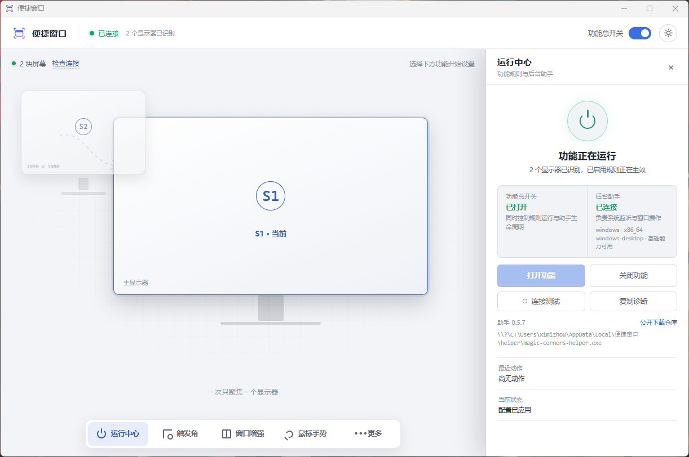
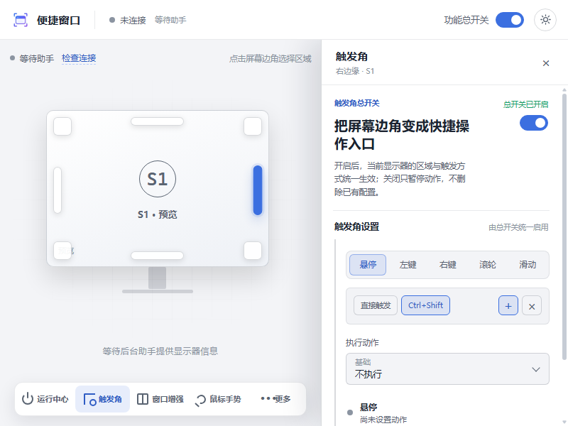
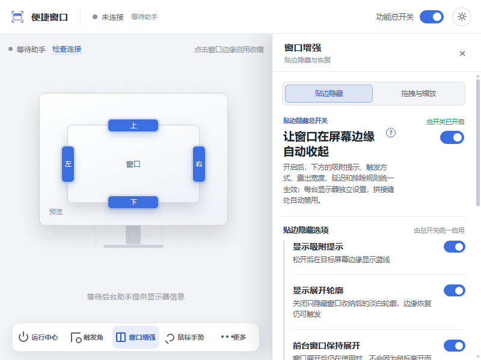
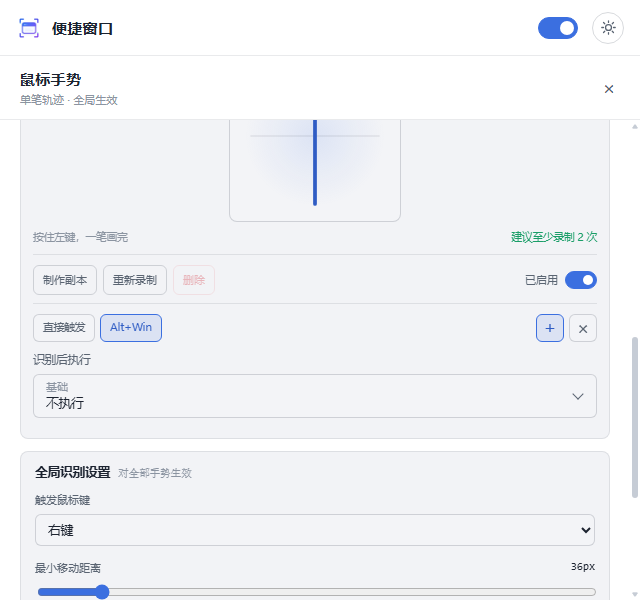

<div align="center">


<h1>便捷窗口</h1>

<p><strong>把屏幕边缘、窗口和鼠标手势变成更快的操作。</strong></p>

<p>Windows 11 x64 · Tauri 2 · Rust · Svelte</p>

<p>
  <a href="https://github.com/ximizhou/convenient_window_free/releases/latest"></a>
  <a href="#平台支持"></a>
  <a href="LICENSE"></a>
</p>

<p><strong>简体中文</strong> · <a href="README.md">English</a></p>

</div>

> 0.6.9 开发分支新增[开机启动管理](docs/startup-apps.md)、本地脱敏诊断与离线显示器配置管理。这些源码变更尚未形成新的正式发布。




便捷窗口是一款常驻 Windows 11 系统托盘的桌面增强工具。你可以逐屏配置四角和四边的热区、让窗口在屏幕边缘自动收纳、用单笔鼠标手势执行常用动作、把截图贴在其他窗口上方，也可以把当前桌面保存成**窗口布局**，之后一键复位。设置实时生效，界面支持中英文，所有处理都在本机完成。

## 0.6.8 更新内容

本版本是当前 Windows 11 x64 正式版；0.6.7 正式版下载继续保留，可随时回滚。

- **中英文修复**：英文模式下设置页、功能入口、底部页签、helper 安装/操作反馈全部跟随语言切换，不再残留中文。
- **底部页签**：改为一词短标签，打开设置抽屉或窗口变窄时不再溢出或遮挡；完整功能名保留在悬停提示和无障碍标签里。
- **功能不变**：热区、贴边收纳、拖拽缩放、鼠标手势、截图/OCR、窗口布局和置顶图钉保持原有行为；helper 本版仅同步版本号。

[更新说明](docs/release-notes/0.6.8.md) · [所有版本](https://github.com/ximizhou/convenient_window_free/releases)

## 界面一览

<table>
  <tr>
    <td width="50%"></td>
    <td width="50%"></td>
  </tr>
  <tr>
    <td align="center"><strong>窗口布局</strong><br/><sub>保存当前桌面，一键恢复。</sub></td>
    <td align="center"><strong>功能入口</strong><br/><sub>拖拽气泡，自由组合底部页签。</sub></td>
  </tr>
  <tr>
    <td width="50%"></td>
    <td width="50%"></td>
  </tr>
  <tr>
    <td align="center"><strong>触发角热区</strong><br/><sub>每台显示器的每个角、每条边都能独立配置。</sub></td>
    <td align="center"><strong>贴边隐藏</strong><br/><sub>窗口自动收起，从露出区域快速恢复。</sub></td>
  </tr>
  <tr>
    <td colspan="2"></td>
  </tr>
  <tr>
    <td colspan="2" align="center"><strong>手势、截图与本地 OCR</strong><br/><sub>内置手势、自定义样本与可编辑动作。</sub></td>
  </tr>
  <tr>
    <td colspan="2"></td>
  </tr>
  <tr>
    <td colspan="2" align="center"><strong>深浅双主题</strong><br/><sub>跟随系统外观，也可手动切换。</sub></td>
  </tr>
</table>

## 功能

**窗口控制**
- **窗口布局**：保存与恢复普通窗口的位置、大小、最大化/最小化和置顶状态，逐窗口校验身份并汇总跳过项。
- **任意位置移动与缩放**：用可配置的修饰键与鼠标组合移动或缩放当前窗口。
- **置顶控制**：让窗口始终置顶；默认显示红色小图钉，点击即可取消置顶。
- **逐显示器配置**：每台显示器独立保存设置，支持带符号的虚拟桌面坐标。

**屏幕边缘**
- **热区**：每台显示器的四个角和四条边，支持悬停、鼠标按键、滚轮和沿边移动触发；半透明悬停提示可单独关闭而不影响动作。
- **热区几何**：逐屏设置角宽/角高（支持比例锁定）、边厚度、居中长度，带实时预览和单区重置。
- **贴边隐藏**：把窗口移出屏幕一部分，从露出的边缘快速恢复，支持多窗口与多显示器；恢复轮廓和动画可独立关闭。

**手势与捕获**
- **全局鼠标手势**：把单笔手势绑定到快捷键、系统动作、命令和窗口操作，最多管理 64 个手势、每个 8 份样本。
- **截图与贴图**：截取区域并置顶显示，可移动、缩放、调透明度、复制或另存为 PNG。
- **本地 OCR**：调用 Windows 本地能力识别文字并复制，不上传截图。

**体验**
- **亮度与音量调节**：在热区和手势里调整对应显示器亮度或输出音量，并显示被动式屏幕提示。
- **实时设置**：大部分修改保存后立即生效，无需额外“应用”。
- **主题与语言**：深浅主题和中文/English 界面，可随时切换。

## 下载

| 包 | 适用情况 |
| --- | --- |
| [安装包（`setup.exe`）](https://github.com/ximizhou/convenient_window_free/releases/latest) | 推荐普通用户按用户级安装。 |
| 便携版 ZIP | 解压即用；压缩包内固定为 `ConvenientWindow-portable` 目录。 |
| 系统要求 | 已发布包仅支持 Windows 11 x64。 |

当前发布资产**未做代码签名**，Windows 可能显示未知发布者或 SmartScreen 提示。每个版本都附带 `SHA256SUMS` 和 `artifact-manifest.json`，可自行校验下载文件。若安全软件拦截 `magic-corners-helper.exe`，请先校验哈希，再检查隔离区或提交误报，不要为此直接关闭防护。

**便携版升级**：把新压缩包解压覆盖到原来的 `ConvenientWindow-portable` 目录即可。设置保存在 Local AppData，不在便携目录内，因此替换文件不会丢失配置。

## 快速上手

1. 下载并安装，或解压便携版。
2. 从系统托盘打开便捷窗口。
3. 打开功能总开关，在底部页签里按需启用触发角、窗口增强、鼠标手势、窗口布局或窗口美化。
4. 在右上角齿轮（设置）里切换深浅主题、界面语言、开机启动和轮询间隔。

关闭设置窗口后托盘程序继续运行；可从托盘菜单重新打开设置或退出。

### 贴边隐藏怎么用

1. 把窗口拖向屏幕边缘，直到出现蓝色提示线。
2. 松开鼠标让窗口收起；顶部边缘需要等蓝线铺满后再松手，提前松手保留系统 Snap。
3. 把鼠标移回露出的边缘区域即可恢复窗口。

## 隐私与安全

- OCR 通过 Windows 本地接口完成，截图不会为识别而上传。
- 配置、令牌、使用统计和日志都保存在本机应用数据目录。
- 本地 IPC 使用随机令牌保护，并带单实例锁。
- 后台助手是独立组件，需要用户明确确认后安装，逐文件校验大小与 SHA-256，可随时停止或删除。

安全问题请按 [SECURITY.md](SECURITY.md) 私下报告。

## 平台支持

| 平台 | 状态 | 说明 |
| --- | --- | --- |
| **Windows 11 x64** | 已发布验收 | 完整功能集，提供 NSIS 安装包与便携版。 |
| macOS（x64 / arm64） | 未验收 | 原生助手边界覆盖输入、窗口控制、显示器与截图；需要辅助功能与屏幕录制权限。OCR、贴边隐藏和任意窗口置顶不可用，不发布安装资产。 |
| Linux X11（x64） | 未验收 | 原生助手支持输入、窗口控制、显示器、截图和 EWMH 置顶；OCR 与贴边隐藏不可用，不发布安装资产。 |
| Linux Wayland | 仅能力探测 | 明确报告不可用，不伪装支持全局输入或任意窗口控制。 |

安装包和程序未做代码签名，也尚未实现自动更新。任务栏材质是默认关闭的 Windows 11 x64 实验功能，支持透明、Acrylic 和纯色染色，面板内保留 Explorer 风险提示。

## 开发者

<details>
<summary><strong>从源码构建与测试</strong></summary>

本仓库是 `apps/desktop/`（Tauri 2 宿主与 Svelte 界面）、`helper/`（共享 Rust 助手）和 `scripts/`（构建、打包、smoke 与产物审计入口）的唯一源码来源。宿主集成以 submodule 方式引用本仓库，只提供自己的宿主适配层。

前置条件：Node.js `24.14.0`（见 `.node-version`）、Windows 11 x64（发布构建）、Rust `1.96.0` 或更新稳定版。Windows helper 还需要 Visual Studio C++ Build Tools 与带 C++/WinRT 头的 Windows SDK；`scripts/windows-toolchain.ps1` 会自动发现，也可用 `VSINSTALLDIR` 指向已有安装。

```powershell
npm ci
npm run desktop:test
npm run desktop:check
npm run desktop:frontend
npm run desktop:build
```

`scripts/build-desktop.ps1 -ArtifactsDir artifacts/<candidate>` 会保留旧产物；路径必须位于仓库的 `artifacts/` 内。打包后的生命周期与产物门禁见 [测试文档](docs/testing.md)，helper 协议与窗口状态机见 [架构文档](docs/architecture.md)。

仅开发 Windows helper 时：

```powershell
rustup run 1.96.0-x86_64-pc-windows-gnullvm cargo fmt --check
rustup run 1.96.0-x86_64-pc-windows-gnullvm cargo test
```

</details>

## 发布完整性

<details>
<summary><strong>发布与校验方式</strong></summary>

干净的 `main` 构建先作为可替换的 Pre-release 候选发布；用户验收通过后，同一批资产原地转为 stable，不重新构建或上传。每个版本都附带绑定源码提交的 `SHA256SUMS` 与产物清单。stable 资产不可变；替换已稳定的二进制必须提升补丁版本并重新打 Tag。

</details>

## 许可证

本项目以 [PolyForm Noncommercial License 1.0.0](LICENSE) 源码开放。你可以按许可证条款查看、学习、修改并用于个人及其他非商业用途；商业使用需要另行获得版权持有者的书面许可。历史上以 MIT License 发布的版本，仍按当时的授权继续可用。
