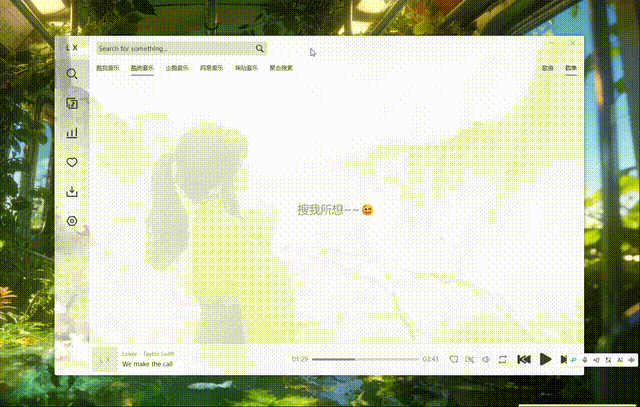
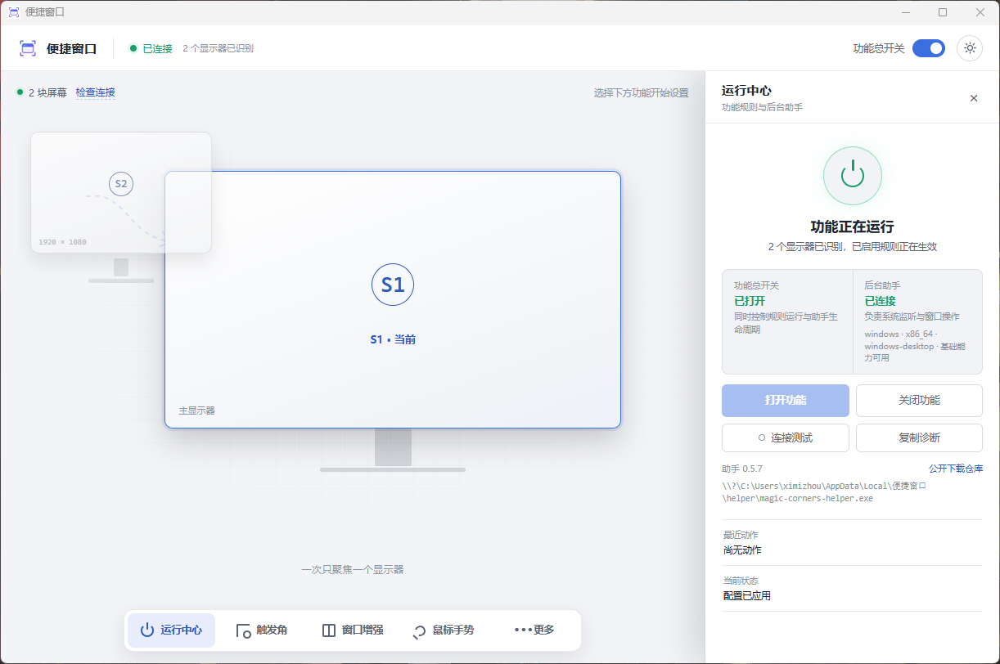
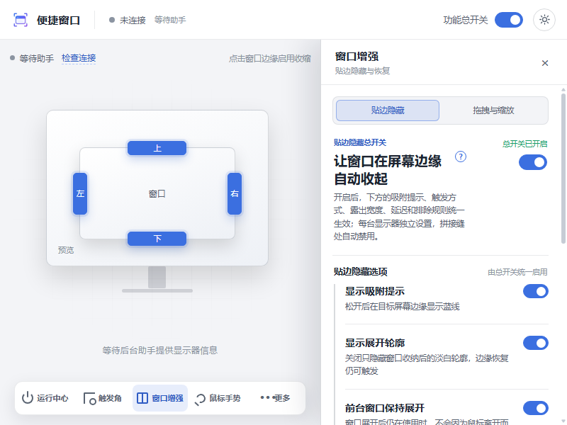
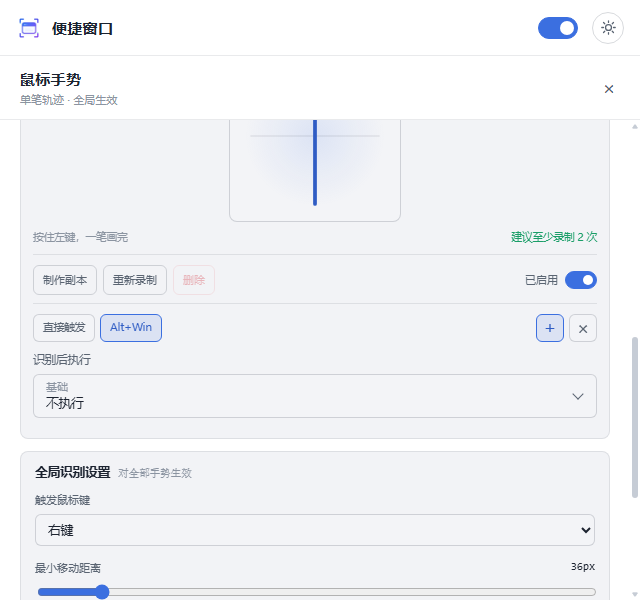
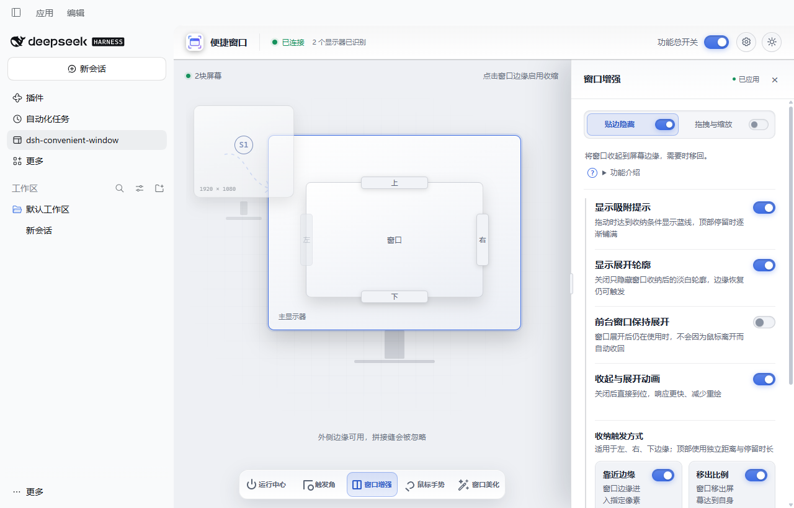

<div align="center">


<h1>便捷窗口 · Convenient Window</h1>

<p><strong>窗口靠边一藏，常用操作随手触发。</strong></p>
<p>专为 Windows 11 打造的轻量桌面效率工具：贴边隐藏、屏幕触发角、鼠标手势、窗口布局与截图贴图。</p>

<p>
  <a href="https://github.com/ximizhou/convenient_window_free/releases/tag/v0.6.11"></a>
  
  
  <a href="LICENSE"></a>
</p>

<p>
  <a href="https://github.com/ximizhou/convenient_window_free/releases/download/v0.6.11/convenient-window-0.6.11-windows-x64-setup.exe"><strong>⬇ 下载 Windows 安装版</strong></a>
  &nbsp;·&nbsp;
  <a href="https://github.com/ximizhou/convenient_window_free/releases/download/v0.6.11/convenient-window-0.6.11-windows-x64-portable.zip">便携版 ZIP</a>
  &nbsp;·&nbsp;
  <a href="docs/release-notes/0.6.11.md">更新说明</a>
  &nbsp;·&nbsp;
  <a href="#也可以在-dsh-中使用">DSH 插件</a>
</p>

<p><strong>简体中文</strong> &nbsp;|&nbsp; <a href="README.md">English</a></p>

<br />



<sub>托盘常驻 · 中英双语 · 深浅主题自适应 · 内置助手开箱即用</sub>

</div>

---

## 为什么用便捷窗口？

窗口开多了桌面乱、想调音量/切桌面还得找按钮、截张图对照资料来回切窗口……便捷窗口把这些高频操作直接做到你的**屏幕边缘和鼠标手势**里，顺手、安静，且全部在本机完成。

<table>
  <tr>
    <td width="50%" valign="top">
      <h3>🧊 窗口贴边隐藏</h3>
      <p>把暂时不用的窗口拖到屏幕左、右、下或顶部，自动收成一条细边；鼠标凑过去立刻滑出来，多窗口和多显示器都好用。</p>
    </td>
    <td width="50%" valign="top">
      <h3>🧭 屏幕触发角与热区</h3>
      <p>每块屏幕的 4 个角和 4 条边都能独立配置——悬停、点击、滚轮或滑动，随手调音量、调亮度、显示桌面或发快捷键。</p>
    </td>
  </tr>
  <tr>
    <td width="50%" valign="top">
      <h3>✍️ 一笔鼠标手势</h3>
      <p>按住右键（或中键/侧键）随手一划，完成复制、粘贴、关闭或置顶窗口；支持自定义录制最多 64 个手势。</p>
    </td>
    <td width="50%" valign="top">
      <h3>🧩 窗口布局一键复位</h3>
      <p>记下当前桌面所有窗口的位置、大小、分屏和贴边状态，随时一键或按全局快捷键恢复到熟悉的工作台。</p>
    </td>
  </tr>
  <tr>
    <td width="50%" valign="top">
      <h3>📌 任意位置拖放 + 置顶图钉</h3>
      <p>按住 <code>Alt + 左/右键</code>，在窗口任意位置直接移动或缩放，不用找细边框；置顶窗口左上角带小红图钉，点一下即取消。</p>
    </td>
    <td width="50%" valign="top">
      <h3>📸 截图贴图 + 本地识字</h3>
      <p>手势画框截屏，把参考图直接钉在最前面，滚轮调透明度；支持 Windows 本地 OCR 提字，图片绝不上传云端。</p>
    </td>
  </tr>
</table>

---

## 界面一览

<table>
  <tr>
    <td width="50%" align="center">
      
      <br />
      <strong>运行中心（浅色）</strong><br />
      <sub>状态一目了然，多屏拓扑实时预览</sub>
    </td>
    <td width="50%" align="center">
      
      <br />
      <strong>深色主题</strong><br />
      <sub>自动跟随系统外观，也可随时手动切换</sub>
    </td>
  </tr>
  <tr>
    <td width="50%" align="center">
      
      <br />
      <strong>触发角与热区</strong><br />
      <sub>每块屏独立改尺寸、配修饰键组合</sub>
    </td>
    <td width="50%" align="center">
      
      <br />
      <strong>贴边隐藏与拖拽缩放</strong><br />
      <sub>独立开关、动画速度与排除应用名单</sub>
    </td>
  </tr>
  <tr>
    <td width="50%" align="center">
      
      <br />
      <strong>窗口布局快照</strong><br />
      <sub>带桌面缩略图，支持一键或快捷键复位</sub>
    </td>
    <td width="50%" align="center">
      
      <br />
      <strong>自由定制底部入口</strong><br />
      <sub>拖一拖气泡，只把常用功能留在底栏</sub>
    </td>
  </tr>
</table>

<details>
<summary><strong>展开查看鼠标手势工作台</strong></summary>
<br />
<p align="center">
  
</p>
</details>

---

## 三步上手

1. **下载运行**：点击上方下载 [**Windows 安装版**](https://github.com/ximizhou/convenient_window_free/releases/download/v0.6.11/convenient-window-0.6.11-windows-x64-setup.exe)（推荐），或下载 [**便携版 ZIP**](https://github.com/ximizhou/convenient_window_free/releases/download/v0.6.11/convenient-window-0.6.11-windows-x64-portable.zip) 解压即用。后台助手已内置，无需额外下载。
2. **按需开启**：从系统托盘打开便捷窗口，打开总开关，按习惯启用需要的功能。
3. **试试贴边隐藏**：把任意普通窗口拖到屏幕边缘，看到蓝色提示线松手即可收起（顶部需稍等蓝线铺满，松手太早会保留系统原生态分屏）；鼠标移回边条就能重新展开。

关闭设置窗口后软件会继续在系统托盘安静运行，右键托盘图标可重新打开或彻底退出。

<details>
<summary><strong>系统支持、隐私与安全校验说明</strong></summary>

- **适用系统**：当前正式安装包面向 **Windows 11 x64**；macOS / Linux 暂未发布本版安装包。
- **纯本地运行**：窗口操控、配置和 OCR 全部在本机完成，不上传任何截图或使用数据；OCR 语言取决于系统已安装的 Windows 语言包。
- **未签名提示与校验**：目前安装包未购买商业代码签名，Windows 可能提示“未知发布者”。[发布页](https://github.com/ximizhou/convenient_window_free/releases/tag/v0.6.11) 附带 `SHA256SUMS` 与 `artifact-manifest.json`，可供核对完整性。
- **便携版更新**：直接把新版压缩包覆盖解压到原目录即可，用户配置保存在系统 Local AppData 中不会丢失。
- **任务栏材质（实验功能）**：默认关闭，支持透明、Acrylic 磨砂与纯色染色，可在「窗口美化」中按需开启。

[全部历史版本](https://github.com/ximizhou/convenient_window_free/releases) · [v0.6.10 回退版本](https://github.com/ximizhou/convenient_window_free/releases/tag/v0.6.10)

</details>

---

## 也可以在 DSH 中使用

如果你已经在用 **DeepSeek Harness (DSH)**，可以直接在 DSH 侧栏中打开同一套便捷窗口设置界面；切页签或最小化 DSH 后，已开启的后台助手仍会继续工作。

<p align="center">
  
</p>

<p align="center">
  <strong>DSH 插件 v0.2.0-beta.3</strong> · 已验收宿主 <strong>DSH 0.2.2-rc.5</strong>（Windows 11 x64）<br />
  <a href="apps/dsh-plugin/README.md#安装">安装与升级说明</a> · <a href="https://github.com/ximizhou/convenient_window_free/releases/tag/dsh-v0.2.0-beta.3">下载插件</a>
</p>

> 插件已内置助手，无需单独下载。桌面版与 DSH 的配置互相独立；如果同时安装，请只开启其中一个的后台助手。

---

## 反馈与开发

遇到问题或有功能建议？欢迎 [提交 Issue](https://github.com/ximizhou/convenient_window_free/issues/new/choose)，附上所用版本（桌面版或 DSH）、Windows 版本与复现步骤。安全漏洞请按 [SECURITY.md](SECURITY.md) 私下反馈。

<details>
<summary><strong>开发者指南：目录结构、构建与文档</strong></summary>

- `apps/desktop/` — Tauri 2 独立桌面宿主与共用 Svelte 设置界面
- `apps/dsh-plugin/` — DSH 侧栏接入、原生适配与回归测试
- `helper/` — 唯一 Rust 引擎源码（全局输入、窗口状态机、截图与 OCR）
- `scripts/` — 构建、产物审计、烟测与发布脚本

构建依赖：Node.js `24.14.0`（`.node-version`）、固定 Rust 工具链（`rust-toolchain`）、Visual Studio C++ Build Tools 与 Windows SDK。

```powershell
npm ci
npm run desktop:install
npm run desktop:test
npm run desktop:check
npm run desktop:build
```

[架构设计](docs/architecture.md) · [测试矩阵](docs/testing.md) · [桌面发布流程](docs/release.md) · [DSH 维护文档](apps/dsh-plugin/README.md#维护者)

</details>

---

## 许可证

源码遵循 [PolyForm Noncommercial License 1.0.0](LICENSE) 提供，允许个人与非商业用途查看、修改和使用；商业用途需另行获得书面授权。此前按 MIT 发布的旧版本继续保留原许可证。
