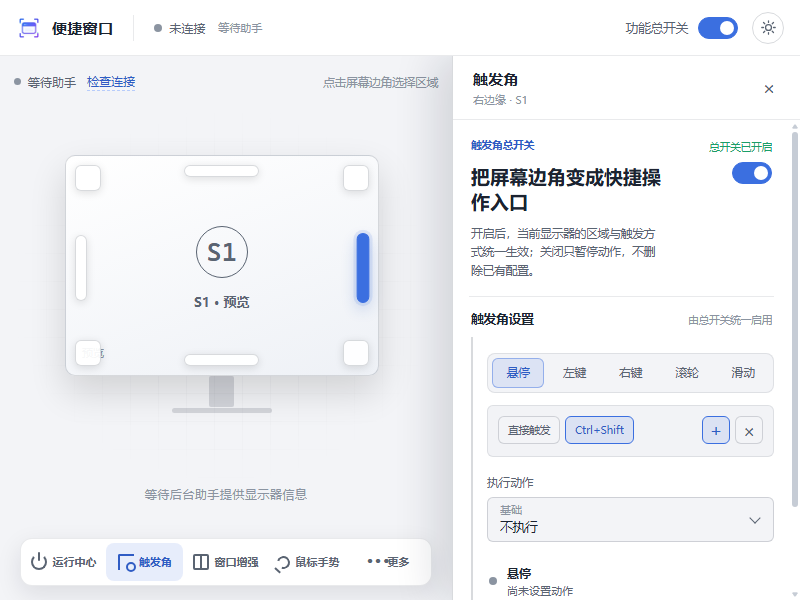

<div align="center">


<h1>便捷窗口</h1>

<p><strong>窗口靠边收起，常用操作随手触发。</strong></p>
<p>触发角、贴边隐藏、鼠标手势和窗口布局，在一个设置页里管理。</p>

<p>
  <a href="https://github.com/ximizhou/convenient_window_free/releases/tag/v0.6.11"></a>
  <a href="https://github.com/ximizhou/convenient_window_free/releases/tag/dsh-v0.2.0-beta.3"></a>
  
</p>

<p><strong>简体中文</strong> · <a href="README.md">English</a></p>

</div>

## 选一个适合你的版本

| 独立桌面版 | DSH 插件版 |
| --- | --- |
| **不需要其他软件，安装后从系统托盘使用。** | **已经在用 DeepSeek Harness？直接在侧栏打开。** |
| 正式版 **0.6.11**；提供安装包和便携版。 | 测试版 **0.2.0-beta.3**；已验收 DSH **0.2.2-rc.5**。 |
| [**下载桌面版**](https://github.com/ximizhou/convenient_window_free/releases/tag/v0.6.11) · [上手步骤](#桌面版上手) | [**安装 DSH 插件**](apps/dsh-plugin/README.md#安装) · [下载与更新说明](https://github.com/ximizhou/convenient_window_free/releases/tag/dsh-v0.2.0-beta.3) |

两个版本使用同一套设置界面和 Rust 窗口引擎，安装包内置助手，无需再下载一份。配置各自保存；使用时只开启其中一个版本的窗口助手。

## 在 DSH 里使用


*真实 DSH 页签截图：左侧打开插件，右侧直接设置窗口功能。切换其他页签或最小化 DSH 后，已开启的助手继续工作。*

首次使用 DSH，先打开一次，再从系统托盘退出。打开 PowerShell，粘贴以下命令：

```powershell
dsh plugin --profile desktop add dsh-convenient-window@0.2.0-beta.3 --ignore-scripts --registry=https://registry.npmjs.org/
```

安装完成后重开 DSH，点击左侧 **dsh-convenient-window**，按需开启功能总开关。

[找不到 dsh 命令、旧名称迁移、升级与卸载](apps/dsh-plugin/README.md#安装) · [反馈问题](https://github.com/ximizhou/convenient_window_free/issues/new/choose)

## 你可以用它做什么

| 功能 | 日常怎么用 |
| --- | --- |
| **贴边隐藏** | 把普通窗口拖到屏幕边缘收起，鼠标回到露出的边条时展开。 |
| **触发角与热区** | 为每块屏幕的四角、四边设置动作，例如显示桌面、调节音量或执行快捷键。 |
| **鼠标手势** | 用单笔手势执行窗口操作、快捷键或自定义动作。 |
| **窗口布局** | 保存当前窗口排列，之后一键恢复位置、大小和相应窗口状态。 |
| **截图、贴图与 OCR** | 截取区域并悬浮显示，通过 Windows 本地能力识别文字。 |
| **窗口控制与偏好** | 任意位置拖动缩放、置顶、启动项管理，以及中英切换和深浅主题。 |

<details>
<summary><strong>展开查看桌面版与更多功能截图</strong></summary>

### 独立桌面版


### 触发角与窗口布局




### 鼠标手势


</details>

## 桌面版上手

1. 从[桌面发布页](https://github.com/ximizhou/convenient_window_free/releases/tag/v0.6.11)下载以 `setup.exe` 结尾的安装包并安装；喜欢免安装的用户可选 portable ZIP。
2. 从系统托盘打开便捷窗口，开启总开关，再启用需要的功能。
3. 把一个未最大化的普通窗口拖向已启用的屏幕边缘，出现蓝线后松手；顶部需要等蓝线铺满。
4. 鼠标回到露出的边条时，窗口会展开。右上角齿轮可以调整语言、主题和功能入口。

关闭设置窗口后，桌面版继续在托盘运行；从托盘菜单退出才会结束。便携版升级时替换程序文件即可，设置保存在本机应用数据目录。

## 这次更新了什么

**DSH 0.2.0-beta.3**

新增 DSH 侧栏入口，复用桌面设置页、原生功能模块和 0.6.11 助手；包名统一为 `dsh-convenient-window`。支持 npm 和 GitHub 安装包两种安装方式。[查看安装与旧包迁移](apps/dsh-plugin/README.md)

**桌面 0.6.11**

修复其他应用退出时贴边窗口意外展开、边条出现在错误虚拟桌面的问题，并加快包含大量手势样本的设置保存。[完整更新说明](docs/release-notes/0.6.11.md)

[所有历史版本](https://github.com/ximizhou/convenient_window_free/releases) · [桌面 0.6.10 回退版本](https://github.com/ximizhou/convenient_window_free/releases/tag/v0.6.10)

## 使用前了解

- **支持范围：** 当前发布并验收的是 Windows 11 x64。DSH 插件仅声明已验收的 DSH 0.2.2-rc.5；其他宿主版本需另行验证。macOS/Linux 保留实现边界，尚无可交付的本版安装包。
- **本机处理：** 窗口操作、设置和 OCR 在本机完成；OCR 不上传截图，识别语言取决于已安装的 Windows 语言包。
- **更新：** 桌面版手动下载安装更新。DSH 插件版本与窗口引擎版本分开管理，宿主适配可以单独更新。
- **配置：** 桌面版与 DSH 配置独立；DSH 按当前 profile 保存。不要同时开启多个宿主的窗口助手。
- **实验功能：** 任务栏材质默认关闭，其实际效果和恢复行为需要按目标系统验证。
- **下载校验：** 当前程序未签名，Windows 可能提示未知发布者。桌面发布附带 `SHA256SUMS` 和清单；DSH 发布页列出包哈希。遇到拦截先核对下载来源和校验值。

## 反馈与开发

[报告问题](https://github.com/ximizhou/convenient_window_free/issues/new/choose)时，请注明使用哪个版本、DSH/插件/Windows 版本，以及复现步骤。安全问题请按 [SECURITY.md](SECURITY.md) 私下报告。

<details>
<summary><strong>源码结构、构建与验证</strong></summary>

- `apps/desktop/`：独立桌面宿主及共用的 Svelte 设置页。
- `apps/dsh-plugin/`：DSH 接入、原生适配、打包和回归测试。
- `helper/`：唯一 Rust 窗口引擎源码。
- `scripts/`：桌面构建、校验和发布工具。

桌面构建使用 Node.js 24.14.0 和仓库指定的 Rust 工具链；Windows 原生构建需 Visual Studio C++ Build Tools 与 Windows SDK。

```powershell
npm ci
npm run desktop:install
npm run desktop:test
npm run desktop:check
npm run desktop:build
```

[架构](docs/architecture.md) · [测试](docs/testing.md) · [桌面发布](docs/release.md) · [DSH 构建与发布](apps/dsh-plugin/README.md#维护者)

桌面正式资产保持不可变。DSH 的 npm 包与 GitHub 附件使用同一份已验收文件；只修改介绍文档不会替换已发布安装包。

</details>

## 许可证

源码按 [PolyForm Noncommercial 1.0.0](LICENSE) 提供，具体使用条件以许可证为准。此前以 MIT 发布的版本继续保留当时的许可。
