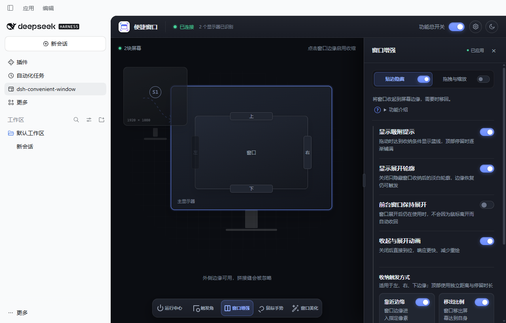

# 便捷窗口 DSH 插件 · 0.2.0-beta.3

**在 DSH 侧栏里，直接管理你的 Windows 窗口。**

触发角、贴边隐藏、鼠标手势、截图贴图和窗口布局，使用与桌面版相同的设置界面。助手已内置，一次安装即可使用。

| 状态 | 适用系统 | 已验收 DSH | 内置助手 |
| --- | --- | --- | --- |
| **Beta 测试版** | Windows 11 x64 | **0.2.2-rc.5** | **0.6.11** |

## 推荐安装方式

首次使用 DSH，先打开一次以创建 `desktop` 配置，再从系统托盘退出。打开 PowerShell 并运行：

```powershell
dsh plugin --profile desktop add dsh-convenient-window@0.2.0-beta.3 --ignore-scripts --registry=https://registry.npmjs.org/
```

重开 DSH，点击左侧 **dsh-convenient-window**，按需开启功能总开关。无需另行安装助手，也无需为本插件配置 API Key。

[完整安装与常见问题](https://github.com/ximizhou/convenient_window_free/blob/main/apps/dsh-plugin/README.md#安装) · [反馈问题](https://github.com/ximizhou/convenient_window_free/issues/new/choose)

## 本版提供



- DSH 左侧独立页签，直接复用桌面设置页及深浅主题、中英切换。
- 触发角、贴边隐藏、鼠标手势、窗口布局和启动项管理等设置入口。
- 同一份 0.6.11 Rust 窗口助手，以及复用桌面模块的原生宿主。
- 切换页签、最小化时继续运行；退出 DSH 时清理本插件拥有的后台进程。
- 插件包及侧栏名称统一为 **dsh-convenient-window**。

<details>
<summary><strong>从 GitHub 下载的 .tgz 安装</strong></summary>

下载本页附件，退出 DSH，在下载目录打开 PowerShell：

```powershell
$pkg = (Resolve-Path -LiteralPath '.\dsh-convenient-window-0.2.0-beta.3.tgz').Path
dsh plugin --profile desktop add "file:$pkg" --ignore-scripts
```

保持联网，不加 `--offline`。DSH 可能需要解析原有插件依赖。保留下载文件，便于重装。

</details>

<details>
<summary><strong>装过旧名称？按这个顺序升级</strong></summary>

旧名称为 `dsh-plugin-convenient-window`。如果开过其登录自启，先在旧页签关闭，然后退出 DSH：

```powershell
dsh plugin --profile desktop remove dsh-plugin-convenient-window
```

移除成功后，再执行上面的新包安装命令。使用同一 profile 时，更名验收已验证配置、窗口布局和界面偏好保留。按需重新开启登录自启。最早的 `0.1.0-beta.1` 迁移时总开关默认关闭。

</details>

## 使用说明

- 本版只声明已验收的 Windows 11 x64 和 DSH 0.2.2-rc.5。其他 DSH 版本需另行验证。
- 桌面版、uTools 和 DSH 的窗口助手不能同时运行；先在原宿主关闭，再启用本插件。
- 贴边隐藏请使用未最大化的普通窗口。多屏/DPI、真实登录和 UAC、OCR 语言包及任务栏效果取决于实际环境。
- DSH 插件设置按 profile 保存，与桌面版独立。配置不会自动跨版本同步。
- 若找不到 `dsh`，使用 DSH 安装目录中的 `resources/runtime/cli/bin/dsh.cmd` 完整路径。具体示例见安装指南。
- 此版维持 beta 状态；页面文案更新不会替换已验收的安装包。

## 下载校验

| 文件 | 大小 |
| --- | --- |
| `dsh-convenient-window-0.2.0-beta.3.tgz` | **6,352,237 字节** |

SHA-256：

```text
c06691a5a736e455c2c26486e6f030d62cf78bc64f8585c876183d68c14aae2e
```

npm 与 GitHub 提供相同文件。程序当前未做代码签名；遇到拦截时先核对来源与校验值。

[本版源码](https://github.com/ximizhou/convenient_window_free/tree/dsh-v0.2.0-beta.3/apps/dsh-plugin) · [桌面正式版](https://github.com/ximizhou/convenient_window_free/releases/tag/v0.6.11) · [English overview](https://github.com/ximizhou/convenient_window_free#use-it-in-dsh)
